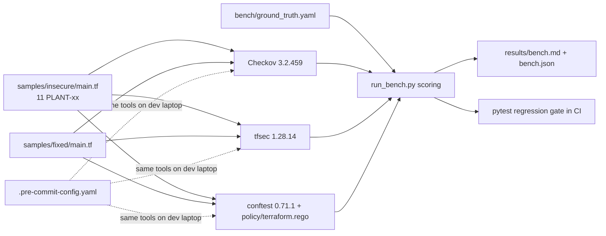

# IaC Scan Bench — Checkov vs tfsec vs custom Rego on planted Terraform misconfigs

> **Lab project.** The Terraform here is never applied. It is test input made of 11 deliberately planted issues plus a hardened counterpart. The "LLM-written Terraform" study is future work (see Limitations).

## Problem
"We run Checkov in CI" doesn't tell you **what it actually catches**. This repo measures it. Each planted misconfiguration is tagged in `samples/insecure/main.tf` and mapped to the rule IDs that count as a hit (`bench/ground_truth.yaml`). Three scanners run, and each is scored for **recall on planted issues** and **noise on the hardened version**. Where both off-the-shelf tools miss something, I fill the gap with my own Rego policy run through conftest.

## Architecture


## Run
```bash
pip install -r requirements-dev.txt     # checkov, pytest
# tfsec + conftest binaries: see .github/workflows/ci.yml
conftest verify -p policy               # Rego unit tests
pytest -q
python bench/run_bench.py               # writes results/bench.md
pre-commit install                      # optional local hooks
```

## Results (actual run, 2026-10-11, local run)
| Tool | Findings (insecure) | Planted detected | Recall | Missed | Findings on fixed | Runtime |
|---|---|---|---|---|---|---|
| Checkov 3.2.459 | 47 | 10/11 | 0.909 | PLANT-05 | 17 | ~3–5 s |
| tfsec 1.28.14 | 30 | 9/11 | 0.818 | PLANT-05, PLANT-11 | 7 | ~1–2 s |
| conftest + my 3 Rego rules | 3 | 3/11 | 0.273 (by design: gap-filler) | rest | 0 | 0.1 s |

**Union of all three: 11/11.** Tests: `conftest verify` 7/7, `pytest` 4/4.

What I learned:
- **Neither scanner flagged the hard-coded RDS password** (`password = "SuperSecret123!"`, PLANT-05). Checkov's secret scanner caught the `AKIA…` key (CKV_SECRET_2). tfsec caught neither secret. A 10-line Rego rule (`deny_literal_password`) closes the gap. In practice, gitleaks in pre-commit is the better layer for secrets anyway.
- **Volume ≠ value.** Checkov produced 47 findings for 11 real issues. On the *hardened* file it still raises 17 best-practice items (Multi-AZ, enhanced monitoring, S3 replication, event notifications…). Without a baseline/skip policy, that noise is what makes developers ignore the gate.
- tfsec flags `aws-iam-no-policy-wildcards` on the fixed policy because `Resource = "<bucket-arn>/*"` contains a wildcard. That's a false positive for object-level access.
- tfsec now prints a "joining Trivy" notice. New projects should use `trivy config`.

## Limitations
- One hand-written file with 11 issues. That's a smoke benchmark, not a statistically meaningful one. The original idea (scan 50 LLM-generated Terraform samples) isn't done yet.
- Ground truth "hit" IDs are my mapping. A different mapping would change the recall numbers.
- `terraform validate/plan` wasn't run (no terraform binary on the box). Scanners work on static HCL only, so module/variable resolution is limited.
- The Rego rules only cover literal values in the same file, not `tfvars` or modules.

## Sources
- Checkov policy index — https://www.checkov.io/5.Policy%20Index/terraform.html
- tfsec AWS checks — https://aquasecurity.github.io/tfsec/latest/checks/aws/
- conftest — https://www.conftest.dev/ ; OPA Rego v1 — https://www.openpolicyagent.org/docs/latest/policy-language/
- tfsec → Trivy migration — https://github.com/aquasecurity/tfsec/discussions/1994

## Related work

This is my own implementation. Ideas came from [kraken222/sovereign-observer-mcp](https://github.com/kraken222/sovereign-observer-mcp).
